<picture>
  <source media="(max-width: 600px) and (prefers-color-scheme: dark)" srcset="assets/banner-m-dark.svg"><source media="(max-width: 600px)" srcset="assets/banner-m-light.svg"><source media="(prefers-color-scheme: dark)" srcset="assets/banner-dark.svg">
  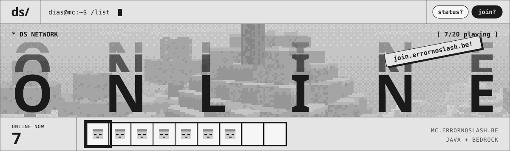
</picture>

<p align="center">
  <picture><source media="(max-width: 600px) and (prefers-color-scheme: dark)" srcset="assets/motd-m-dark.svg"><source media="(max-width: 600px)" srcset="assets/motd-m-light.svg"><source media="(prefers-color-scheme: dark)" srcset="assets/motd-dark.svg"></picture>
</p>

<p align="center">
  <a href="https://join.errornoslash.be"><picture><source media="(prefers-color-scheme: dark)" srcset="assets/link-join-dark.svg"></picture></a>
  <a href="https://join.errornoslash.be/admin.html"><picture><source media="(prefers-color-scheme: dark)" srcset="assets/link-admin-dark.svg"></picture></a>
  <a href="https://github.com/ErrorNoSlash/mc-site/actions/workflows/plugin.yml"><picture><source media="(prefers-color-scheme: dark)" srcset="assets/link-plugin-dark.svg"></picture></a>
  <a href="https://mc-api.errornoslash.be/api/status"><picture><source media="(prefers-color-scheme: dark)" srcset="assets/link-status-dark.svg"></picture></a>
</p>

<p align="center">
  <picture>
    <source media="(max-width: 600px) and (prefers-color-scheme: dark)" srcset="assets/terminal-m-dark.svg"><source media="(max-width: 600px)" srcset="assets/terminal-m-light.svg"><source media="(prefers-color-scheme: dark)" srcset="assets/terminal-dark.svg">
    
  </picture>
</p>

---

## 📌 Pages

<p align="center">
  <a href="https://join.errornoslash.be"><picture><source media="(max-width: 600px) and (prefers-color-scheme: dark)" srcset="assets/page-join-m-dark.svg"><source media="(max-width: 600px)" srcset="assets/page-join-m-light.svg"><source media="(prefers-color-scheme: dark)" srcset="assets/page-join-dark.svg"></picture></a><a href="https://join.errornoslash.be/admin.html"><picture><source media="(max-width: 600px) and (prefers-color-scheme: dark)" srcset="assets/page-admin-m-dark.svg"><source media="(max-width: 600px)" srcset="assets/page-admin-m-light.svg"><source media="(prefers-color-scheme: dark)" srcset="assets/page-admin-dark.svg"></picture></a><br><a href="api/"><picture><source media="(max-width: 600px) and (prefers-color-scheme: dark)" srcset="assets/page-api-m-dark.svg"><source media="(max-width: 600px)" srcset="assets/page-api-m-light.svg"><source media="(prefers-color-scheme: dark)" srcset="assets/page-api-dark.svg"></picture></a><a href="velocity-plugin/"><picture><source media="(max-width: 600px) and (prefers-color-scheme: dark)" srcset="assets/page-plugin-m-dark.svg"><source media="(max-width: 600px)" srcset="assets/page-plugin-m-light.svg"><source media="(prefers-color-scheme: dark)" srcset="assets/page-plugin-dark.svg"></picture></a>
</p>

## 🧱 How it works

<p align="center">
  <a href="https://join.errornoslash.be"><picture><source media="(max-width: 600px) and (prefers-color-scheme: dark)" srcset="assets/how-it-works-m-dark.svg"><source media="(max-width: 600px)" srcset="assets/how-it-works-m-light.svg"><source media="(prefers-color-scheme: dark)" srcset="assets/how-it-works-dark.svg"></picture></a>
</p>

## 📝 server.properties

<p align="center">
  <picture><source media="(max-width: 600px) and (prefers-color-scheme: dark)" srcset="assets/server-properties-m-dark.svg"><source media="(max-width: 600px)" srcset="assets/server-properties-m-light.svg"><source media="(prefers-color-scheme: dark)" srcset="assets/server-properties-dark.svg"></picture>
</p>

<details>
<summary>🛠️ Set it up</summary>

<br>

**1. Folders on the server.** The API and the itzg images all run as uid 1000:

```bash
sudo mkdir -p /data/minecraft/whitelist /data/minecraft/velocity/plugins/ds-whitelist
sudo chown -R 1000:1000 /data/minecraft/whitelist /data/minecraft/velocity/plugins/ds-whitelist
```

**2. The plugin.** Download it from **Actions → Build plugin → the latest green run → Artifacts → ds-whitelist**, and copy the jar into Velocity's plugins folder. It needs Velocity 4 on Java 25, which `itzg/mc-proxy:java25` has.

```bash
cp ds-whitelist-1.0.0.jar /data/minecraft/velocity/plugins/
gh attestation verify ds-whitelist-1.0.0.jar -R ErrorNoSlash/mc-site   # optional: proves it was built here
```

**3. The API.** Clone this repo next to your Minecraft `docker-compose.yml` as `mc-site/`. Copy the `whitelist-api` service and the `internal` network from [`server/docker-compose.yml`](server/docker-compose.yml), and the lines from [`server/.env.example`](server/.env.example) into your `.env`. Make the admin token with `openssl rand -hex 32`.

```bash
docker compose up -d --build whitelist-api
docker compose restart velocity
docker compose logs whitelist-api velocity | grep -i whitelist   # → "Whitelist loaded: 0 players, NOT enforced"
```

**4. HTTPS.** In Nginx Proxy Manager, add a Proxy Host from `mc-api.errornoslash.be` to `http://Whitelist-API:8080`, with a Let's Encrypt certificate and **Force SSL** on.

**5. ntfy.**

```bash
docker exec -it Ntfy ntfy user add mc-whitelist
docker exec -it Ntfy ntfy access mc-whitelist mc-whitelist write-only
docker exec -it Ntfy ntfy token add mc-whitelist                     # tk_…  → NTFY_TOKEN in .env
docker exec -it Ntfy ntfy access YOUR_USER mc-whitelist read-only    # so your phone may subscribe
```

Subscribe to `mc-whitelist` in the ntfy app, then press **test** on the admin page. If it fails, the admin page says why: `ENOTFOUND` means the API isn't on the `Internal` network, and `401/403` means the token or its access is wrong.

**6. Turn it on.** Open [`join.errornoslash.be/admin.html`](https://join.errornoslash.be/admin.html), paste the token, add yourself, let the regulars join once, press **add all**, then switch **OFF** to **ON**.

**Deploy.** The site is served with GitHub Pages: **Settings → Pages → Source: GitHub Actions**, custom domain `join.errornoslash.be`, plus a DNS `CNAME` record (DNS only) pointing `join` at `errornoslash.github.io`. Every push to `site/` deploys it.

</details>

<details>
<summary>⚙️ Customize</summary>

<br>

| to change         | edit                                                                |
| ----------------- | ------------------------------------------------------------------- |
| the addresses     | `site/scripts/config.js` (API, Java and Bedrock addresses)          |
| the splash texts  | the `splashes` list in `site/scripts/config.js`                     |
| the player heads  | `headsUrl` in `site/scripts/config.js` (`""` for plain pixel heads) |
| the panorama      | the constants at the top of `site/scripts/panorama.js`              |
| the colours       | the CSS variables at the top of `site/styles/style.css`             |
| the servers shown | `STATUS_SERVERS` in the compose file                                |
| the kick message  | the admin page (MiniMessage; `{name}` and `{site}` are filled in)   |

</details>

<details>
<summary>🔐 Security</summary>

<br>

| piece          | how                                                                                   |
| -------------- | ------------------------------------------------------------------------------------- |
| **workflows**  | every action pinned to a full commit SHA, no permissions by default, Dependabot weekly |
| **plugin jar** | built in GitHub Actions with a signed build-provenance attestation                    |
| **container**  | Node 26 LTS, unprivileged user, read-only filesystem, no Linux capabilities           |
| **admin**      | token only ever in a header, compared in constant time, wrong guesses rate-limited    |
| **requests**   | Java names checked with Mojang, 3 an hour per address, a hidden field for bots        |
| **whitelist**  | Java by UUID, Bedrock by Floodgate name (Java names can't contain the dot)            |
| **ntfy buttons** | signed links that work once and expire after 7 days                                 |

</details>

<details>
<summary>📚 API and settings</summary>

<br>

| method   | path                                        | who              |
| -------- | ------------------------------------------- | ---------------- |
| `GET`    | `/api/status`                               | anyone           |
| `POST`   | `/api/requests` `{edition, name, note}`     | anyone           |
| `GET`    | `/api/requests/lookup?edition=&name=`       | anyone           |
| `POST`   | `/api/act/:id/approve\|deny?exp=&sig=`      | signed ntfy link |
| `GET`    | `/api/admin/overview`                       | token            |
| `POST`   | `/api/admin/requests/:id/approve\|deny`     | token            |
| `DELETE` | `/api/admin/requests/:id`                   | token            |
| `POST`   | `/api/admin/players` `{edition, name}`      | token            |
| `DELETE` | `/api/admin/players/:key`                   | token            |
| `PUT`    | `/api/admin/settings` `{enforced, message}` | token            |
| `POST`   | `/api/admin/test-notification`              | token            |

| variable                    | default                     | meaning                                          |
| --------------------------- | --------------------------- | ------------------------------------------------ |
| `ADMIN_TOKEN`               | required                    | the admin password; also signs the ntfy buttons  |
| `SITE_URL`                  | required                    | the site, for CORS, the kick message and ntfy    |
| `ALLOWED_ORIGINS`           | required                    | origins allowed to call the API                  |
| `PUBLIC_API_URL`            |                             | the API's https address, for the ntfy buttons    |
| `CLIENT_IP_HEADER`          |                             | the header holding the visitor's address         |
| `STATUS_SERVERS`            | `DS Network=velocity:25565` | `name=host:port, …`; the first is the proxy      |
| `STATUS_CACHE_SECONDS`      | `15`                        | how often the servers are pinged at most         |
| `STATUS_SHOW_PLAYERS`       | `true`                      | show online player names                         |
| `FLOODGATE_PREFIX`          | `.`                         | must match Floodgate's `username-prefix`         |
| `FLOODGATE_REPLACE_SPACES`  | `true`                      | must match Floodgate's `replace-spaces`          |
| `MAX_PENDING`               | `100`                       | stop taking requests above this many waiting     |
| `NTFY_URL`                  | `https://ntfy.sh`           | your ntfy; here `http://Ntfy`                    |
| `NTFY_TOPIC` / `NTFY_TOKEN` |                             | the topic and access token                       |
| `NTFY_PRIORITY`             | `3`                         | 1 to 5; compose sets `4` so requests buzz        |

Data lives in `/data/minecraft/whitelist/` (`requests.json`, `whitelist.json`). Back it up with the worlds.

</details>

<details>
<summary>📁 Structure</summary>

<br>

```
.
├── site/                 # GitHub Pages: index.html, admin.html, scripts, styles, fonts
├── api/                  # the whitelist API (Node 26, no dependencies) + Dockerfile
├── velocity-plugin/      # the DS Whitelist plugin (Velocity 4, Java 25)
├── server/               # your Minecraft compose with the API added, and .env.example
├── assets/               # this README's SVGs, build.py, and its inputs in src/
└── .github/              # deploy + plugin workflows, Dependabot
```

</details>

<details>
<summary>🛠️ How this README works</summary>

<br>

No widgets, no third-party cards. Like the profile README, the banner and the terminal are hand-written SVGs, animated with SMIL and a little CSS, in a dark and a light version that follow your system theme. They also come in a narrow version for phones. The site's pixel fonts (Monocraft and Pixelify Sans) are embedded in each one, and the block world under the marquee is the site's own panorama.

| piece        | what moves                                                                       |
| ------------ | -------------------------------------------------------------------------------- |
| **banner**   | the DS blocks pop in and flicker, the prompt types in-game commands, the title glitches, the marquee scrolls over the block world |
| **terminal** | types five commands and prints their output, then starts over                    |
| **the rest** | the motd, the page cards, `how-it-works.md`, `server.properties` and the buttons rise in once, the cursors blink |

They're generated by [`assets/build.py`](assets/build.py): change `COMMANDS`, `SESSION`, `MARQUEE`, `MOTD`, `PAGES` or `FOOTER` and run `python3 assets/build.py`.

Fonts: [Monocraft](https://github.com/IdreesInc/Monocraft) by Idrees Hassan and [Pixelify Sans](https://github.com/eifetx/Pixelify-Sans), both SIL Open Font License 1.1 (licences in `assets/src/` and `site/fonts/`). Player heads on the site by [mc-heads.net](https://mc-heads.net). Not an official Minecraft product; not approved by or associated with Mojang or Microsoft.

</details>

---

<p align="center">
  <a href="https://contact.errornoslash.be"><picture><source media="(prefers-color-scheme: dark)" srcset="assets/footer-copy-dark.svg"></picture></a>
  <a href="https://hello.errornoslash.be"><picture><source media="(prefers-color-scheme: dark)" srcset="assets/footer-website-dark.svg"></picture></a>
  <a href="https://blog.errornoslash.be"><picture><source media="(prefers-color-scheme: dark)" srcset="assets/footer-blog-dark.svg"></picture></a>
  <a href="https://contact.errornoslash.be"><picture><source media="(prefers-color-scheme: dark)" srcset="assets/footer-contact-dark.svg"></picture></a>
  <a href="https://gitlab.com/ErrorN0Slash"><picture><source media="(prefers-color-scheme: dark)" srcset="assets/footer-gitlab-dark.svg"></picture></a>
  <a href="https://mastodon.social/@slashy" rel="me"><picture><source media="(prefers-color-scheme: dark)" srcset="assets/footer-mastodon-dark.svg"></picture></a>
</p>
